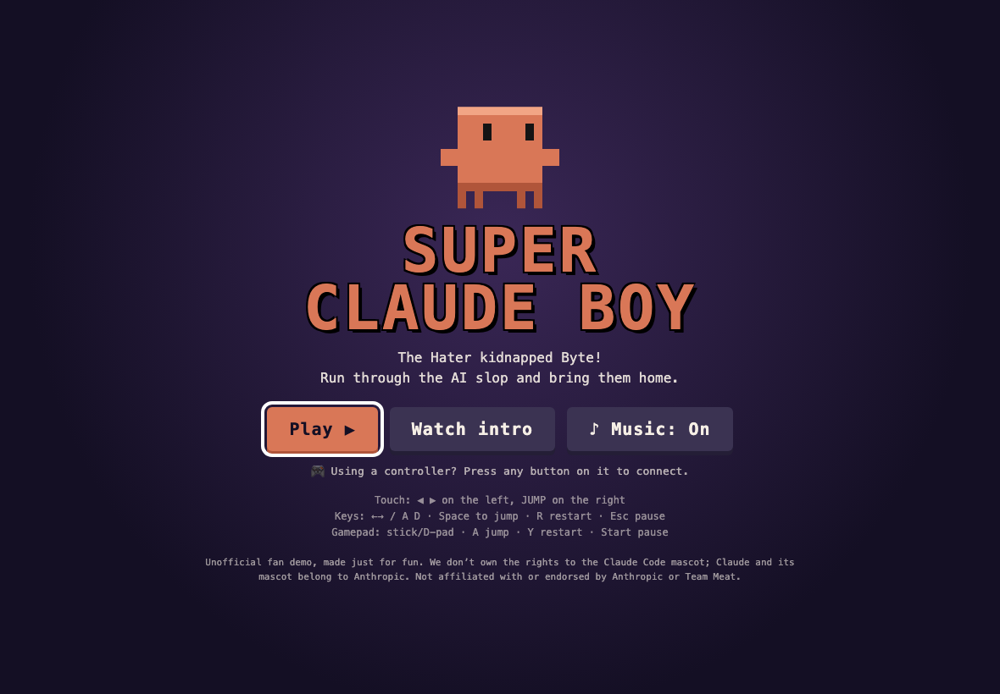
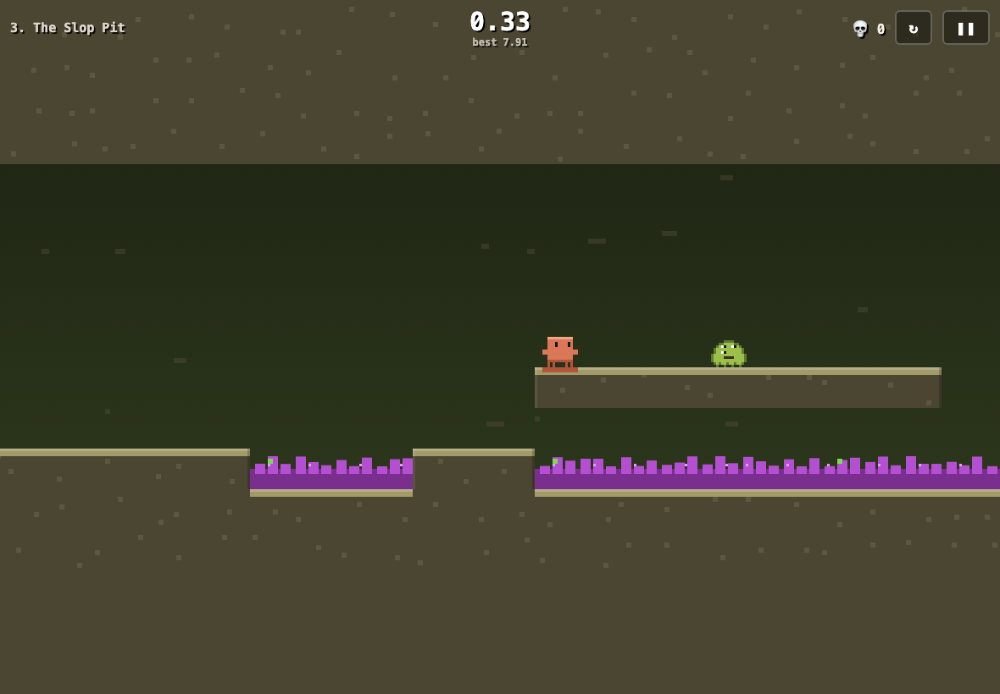
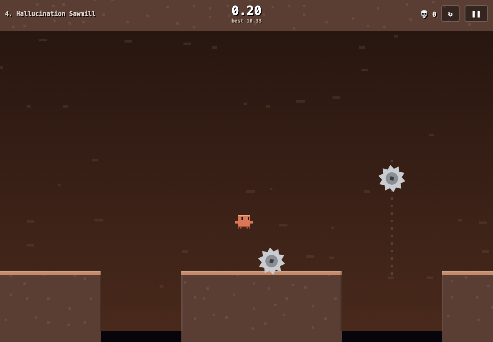
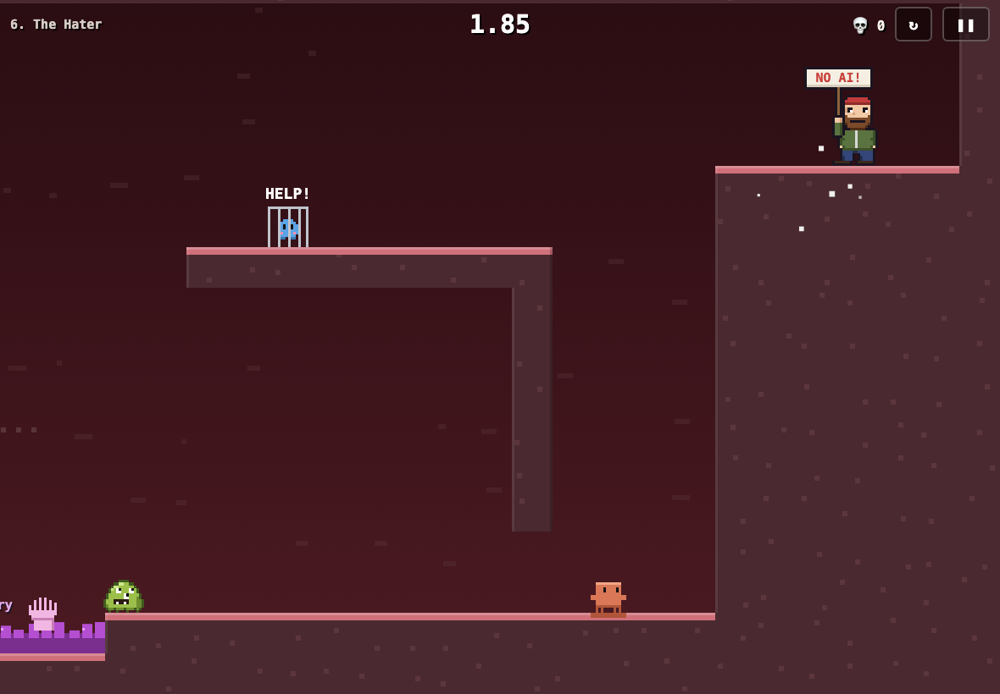
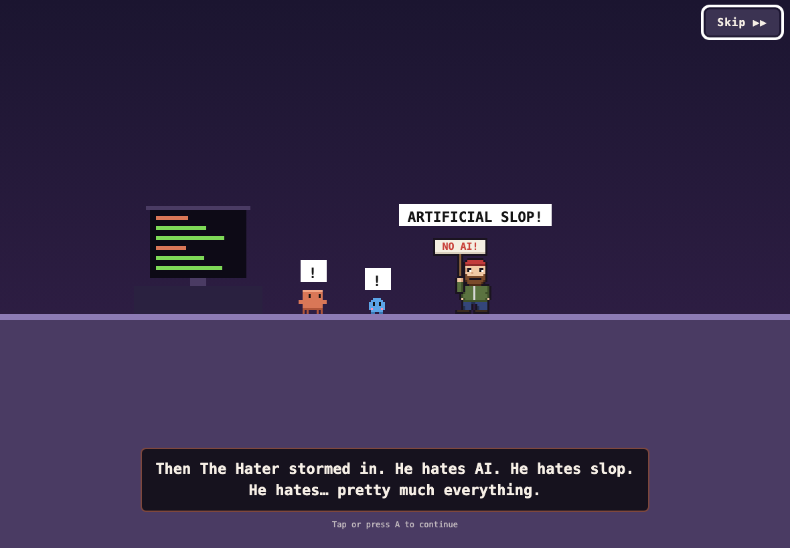
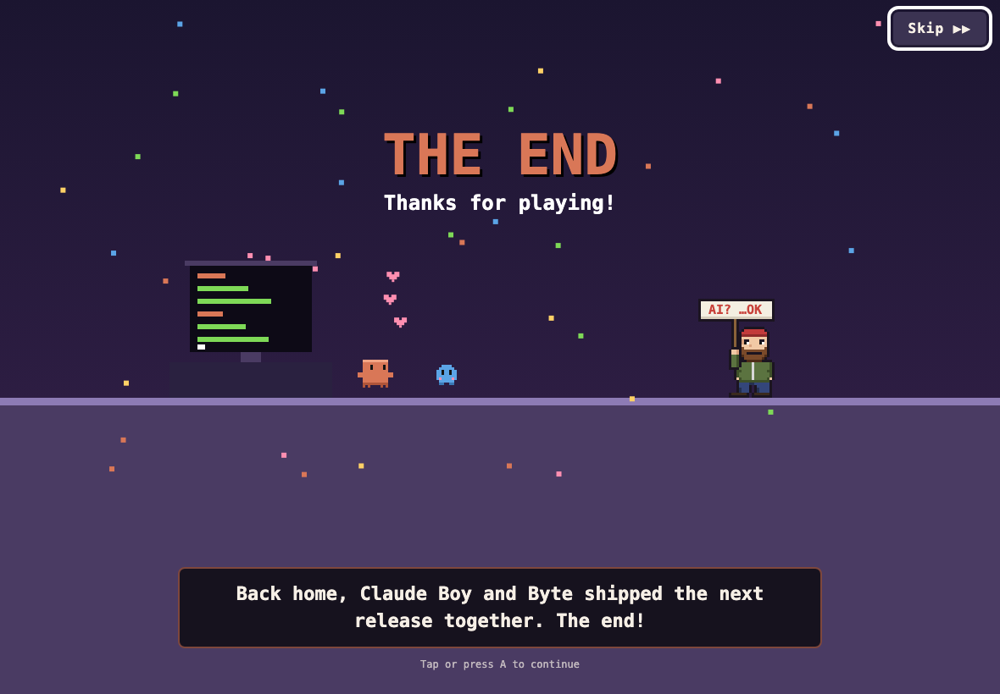
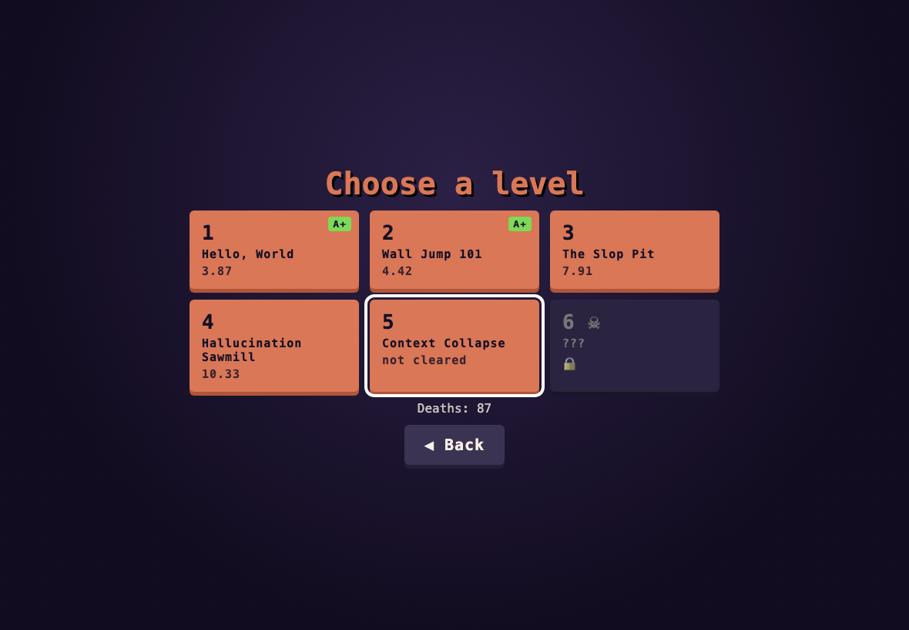

# Super Claude Boy

A tough-as-nails speedrun platformer in the spirit of Super Meat Boy, starring the Claude Code mascot.
The Hater has kidnapped Byte. Run, wall-jump, and dodge AI slop, saws, scraper bots, reply guys and angry protesters to get them back.

**Play:** https://mariotristan.github.io/super-claude-boy/



| | |
|---|---|
|  |  |
|  |  |
|  | |



## About

Super Claude Boy is a fan-made love letter to two things:

- **[Super Meat Boy](https://supermeatboy.com/)** (Team Meat, 2010). It inspired the brutal-but-fair level design, instant respawns, wall jumps, the trail the hero leaves on every surface, the kidnapped friend, and the obsession with shaving milliseconds off a run.
- **The Claude Code mascot**, the little orange pixel creature in the terminal, recast as a platform hero. His friend Byte stands in for Bandage Girl.

The villains poke fun at the AI conversation from both sides. **AI slop** shows up as the hazards: oozing purple goo that bubbles up slop phrases ("delve", "tapestry", "✨synergy✨", "As an AI…") and the occasional six-fingered hand, glitchy "hallucinated" saws, and blobs with too many eyes that say "Great question!". **The Hater** and his sign-waving protesters stand in for the people who want no AI anywhere, ever. Later levels bring in more of the internet: **Scraper Bots** (drones that hum "robots.txt? lol" while patrolling set paths), **Hype Bros** (sprinting in fleece vests, yelling "AGI next week!"), **Reply Guys** (hopping on the spot, phone out: "Well, actually…") and **Keyboard Warriors** (raging at a laptop, firing ALL CAPS comments across the room). Beat him and the ending has a twist: he gets a demo and quietly updates his sign. It's all in good fun.

The game was built with [Claude Code](https://claude.com/claude-code) as a small experiment in making a complete, polished, installable game with no engine and no build step.

**Music:** every track is an original chiptune composed for this game and synthesized live in the browser with the Web Audio API (`src/music.js`). There are no audio files and no third-party music or samples, so there are no licensing strings attached.

*Super Claude Boy is an unofficial fan project. It is not affiliated with or endorsed by Anthropic or Team Meat. Super Meat Boy is a trademark of Team Meat; Claude and Claude Code are trademarks of Anthropic.*

## Install on iPad

1. Open the link above in Safari.
2. Tap **Share → Add to Home Screen**.
3. Launch it from the home screen. It runs full-screen and works offline after the first load.

## Controls

| | Move | Jump | Restart | Pause |
|---|---|---|---|---|
| Touch | ◀ ▶ (left half of screen) | right half of screen | ↻ button | ❚❚ button |
| Keyboard | ← → / A D | Space / ↑ / W / Z | R | Esc / P |
| Gamepad | stick / D-pad | A | Y / X | Start |

Hold jump longer to jump higher. Jump into a wall, then jump again to wall-jump.
Die more than three times on a level and the game starts showing tips for it.

## Speedrunning

- The timer starts on your first input and runs on a fixed 120 Hz simulation, so times are fair and deterministic.
- Each level saves your best time and shows a **ghost** of that run.
- Beat the par time for an **A+**.

## Levels

Twenty levels, then the credits. Levels 15–19 are a trip through Latin America, each with villains dressed for the country:

| # | Level | What it teaches |
|---|---|---|
| 1 | Hello, World | Running, variable-height jumps, the first slop pool |
| 2 | Wall Jump 101 | Wall slides and wall jumps in two shafts |
| 3 | The Slop Pit | Slop blobs and protesters that patrol and turn at edges |
| 4 | Hallucination Sawmill | Static, moving and orbiting saws |
| 5 | Context Collapse | Crumbling blocks over a slop lake |
| 6 | Token Limit | A tall climb up a shaft guarded by a saw |
| 7 | Prompt Injection | A long run past walkers with saws over the pits |
| 8 | Rate Limited | A chain of crumbling blocks under orbiting saws |
| 9 | Merge Conflict | Everything at once, right before the boss |
| 10 | Web Scraper | Scraper Bots patrolling over the pits, on lines, loops and lifts |
| 11 | Reply Guys | Hopping Reply Guys in a low corridor and fast Hype Bros |
| 12 | All Caps | Three floors of Keyboard Warriors firing ALL CAPS shots |
| 13 | Hype Cycle | Up the peak of inflated expectations, through the trough, onto the plateau |
| 14 | Dead Internet | Every new villain at once, up a bot-guarded shaft |
| 15 | Pirámide del Sol (México) | Climbing a stepped pyramid past skull-faced Calaveras protesters |
| 16 | Cumbre Cafetera (Colombia) | A wall-jump climb past furious coffee-bean blobs |
| 17 | Machu Picchu (Perú) | Crumbling stone terraces patrolled by Cóndor drones |
| 18 | Carnaval do Rio (Brasil) | Sprinting samba-dancer Hype Bros between floats |
| 19 | Tango en Buenos Aires (Argentina) | Mate-sipping Reply Guys and football-fan Keyboard Warriors |
| 20 | The Hater | The boss throws signs and tomatoes while you climb to Byte |

## How it's built

Plain HTML, CSS and JavaScript (ES modules) drawing on a single `<canvas>`. There is no engine, no framework, no build step and no dependencies: about 2,700 lines in total.

```
index.html        screens (title, intro, level select, results, pause, ending) as plain HTML
style.css         layout, touch controls, safe areas for the iPad notch and home bar
src/main.js       game loop, rendering, camera, screens, saving, ghosts, intro and outro scenes
src/physics.js    level parsing, movement, collision, saws, walkers, the boss (no DOM)
src/levels.js     the twenty levels as text maps, plus hints, tips and par times
src/sprites.js    pixel-art sprites written as strings, baked into small canvases at startup
src/input.js      touch zones, keyboard and gamepad, merged into one input state
src/audio.js      sound effects synthesized with Web Audio
src/music.js      the soundtrack: note patterns and a small step sequencer
sw.js             service worker for offline play
tools/solve.mjs   proves every level can be finished
```

### The game loop and physics

- **Fixed timestep.** The simulation always advances in steps of 1/120 of a second, however fast the screen refreshes. Each frame simply draws the latest state. Because each step is identical on every device, the same inputs always produce the same run, which is what makes times fair and ghosts possible.
- **The timer counts steps, not wall-clock time.** A run's time is `steps × 1/120 s`, so a dropped frame can't cost you a record. The world (saws, walkers) stays frozen until your first input, and the timer starts with it.
- **Movement** (`stepPlayer` in `src/physics.js`) uses hand-tuned constants in the `P` table: fast acceleration, a run speed cap, stronger gravity when you let go of jump early (short hops), a capped fall speed, slower sliding when you hold toward a wall, and a short lockout after a wall jump so you kick away from the wall.
- **Forgiveness** is built in the way speedrun platformers do it: *coyote time* (you can still jump for 0.08 s after running off a ledge) and a *jump buffer* (pressing jump up to 0.1 s before landing still counts).
- **Collision** moves the player along the x axis, resolves against solid tiles, then does the same along y. Hazards use slightly smaller hitboxes than they look, so close calls feel fair.

### Levels are text

Each level in `src/levels.js` is a grid of characters: `#` solid, `^` slop, `c` crumbling block, `o` saw, `b` blob, `p` protester, `f` Hype Bro, `r` Reply Guy, `k`/`K` Keyboard Warrior (facing left/right), `H` the boss, `S` start, `G` Byte. Moving saws are listed separately as paths or orbits; add `bot: true` to one and it becomes a Scraper Bot. Editing a level means editing the map, then running the solver:

```sh
node tools/solve.mjs          # all levels
node tools/solve.mjs 5        # just level 6
node tools/solve.mjs --static # ignore moving hazards
```

The solver imports the game's real physics and does a breadth-first search over button presses (left, right or neither, with jump held or not, every 1/30 s). It replays the moving saws, bots, walkers and Keyboard Warrior shots on the same timeline as the game, so a level only passes if there's a path that dodges them too. It prints the fastest path it found, which is where the par times come from. It doesn't model the boss's throws, and it treats crumbling blocks as solid.

### Drawing

- **Pixel-perfect scaling.** The camera picks the largest whole-number scale that shows about 15 tiles of height, so every game pixel maps to an exact square of screen pixels: crisp on the iPad's Retina screen, with no seams between tiles.
- **Sprites are strings.** Claude Boy, Byte, The Hater, protesters, blobs, Hype Bros, Reply Guys, Keyboard Warriors and Scraper Bots are drawn as rows of characters in `src/sprites.js` (one character per pixel, with a palette), baked once into small canvases and flipped for facing left.
- **Juice:** squash and stretch on jumps and landings, an orange trail on every surface Claude Boy touches, particles and screen shake on death, a glitch effect on saws, and slop pools that bubble up AI clichés and the occasional six-fingered hand.
- **Ghosts.** During a run the game records Claude Boy's position every other step. A new best time saves that recording, and the next attempt replays it as a translucent ghost.

### Input

- **Touch** uses one full-screen layer instead of separate buttons: the left half is ◀ ▶ (split at the midpoint between the two buttons, so you can slide your thumb), the right half is jump. Pointer events track every finger independently, and default touch gestures (zoom, text selection, the iOS magnifier) are switched off.
- **Gamepads** are polled every frame through the Gamepad API (standard mapping: stick or D-pad, A to jump, Y to restart, Start to pause). The game shows a message when a controller connects or disconnects.
- **Keyboard** works everywhere, and all three drive the menus as well as the game.
- A jump press is remembered until the next physics step uses it, so a very quick tap between steps is never lost.

### Sound and music

Everything is synthesized live with the Web Audio API. There are no audio files.

- **Sound effects** are short oscillator sweeps and filtered noise.
- **Music** is written as data in `src/music.js`: each track has a tempo, a chord per bar, an 8th-note melody (`'E5 - G5 -'`) and 16-step bass and drum patterns. A small sequencer schedules notes slightly ahead of time on the audio clock, so the beat stays steady even when the game is busy. Each level has its own track, plus themes for the title and the ending.
- iOS only allows audio after a tap, so the audio context starts on your first touch or key press.

### Offline and installable

- `manifest.webmanifest` and the Apple meta tags make it installable full screen, in landscape, with its own icon (generated by `tools/make-icons.py` with pure Python).
- `sw.js` caches every file on first load and serves from the cache afterwards, refreshing it in the background. Bumping `CACHE` in `sw.js` is what makes installed copies pick up a new version.
- Progress (best times, ghosts, unlocked levels, death count, settings) lives in `localStorage` on the device.

## Development

No build step. Serve the folder and open it:

```sh
python3 -m http.server 8080
# open http://localhost:8080/        (append ?play=3 to jump straight into level 3)
```

- Run `node tools/solve.mjs` after changing a level.
- Bump `CACHE` in `sw.js` when you ship changes, so installed copies update.
- `python3 tools/make-icons.py` regenerates the icons.
